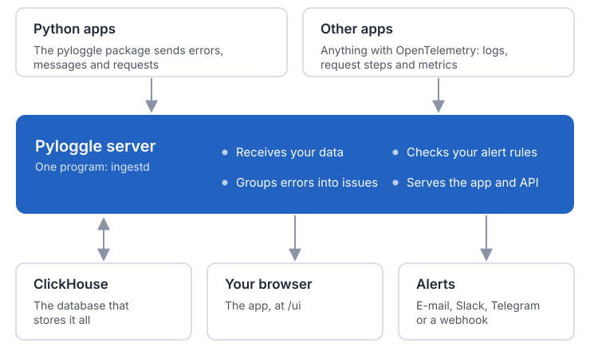

# Pyloggle

[](https://github.com/koneb71/pyloggle/actions/workflows/ci.yml)
[](https://koneb71.github.io/pyloggle/)
[](https://pypi.org/project/pyloggle/)
[](LICENSE)

**Errors, logs, request timelines and alerts for your Python apps, on your own server.**

Pyloggle groups your errors into issues with the full story (the code that failed, its
variables, the steps before, the request, the people affected), makes every log message
searchable, shows each request step by step, and tells you when something goes wrong. It is
one Go program and ClickHouse, small enough for a single 2 GB server, and open source under
the Apache License 2.0.


**[Documentation](https://koneb71.github.io/pyloggle/)** ·
**[Quick start](https://koneb71.github.io/pyloggle/introduction/quick-start)** ·
**[Releases](https://github.com/koneb71/pyloggle/releases)**

## What you get

- **Errors you can act on.** Each report carries the line that failed, local variables, chained
  causes, the steps just before, the web request and the person affected (counted, not named).
  Errors are grouped by their path through your code, not by line numbers. Resolve one, and you
  see the moment it comes back; mark it fixed in the next version, and servers still running the
  old one do not reopen it.
- **Logs you can search.** Type words or `service:api level:error duration_ms:>1000`, or click
  filters. Similar messages are grouped, charts show p95 by route, live mode follows new
  messages, and any search can be saved or exported.
- **Every request, step by step.** OpenTelemetry request timelines across all your apps, with
  the messages and errors of each request.
- **Alerts worth reading.** E-mail, Slack, Telegram or webhooks when a new problem appears, an old
  one comes back, errors jump, or a search matches. Each problem alerts once, and a recap of
  yesterday arrives every morning.
- **Made for Python.** One package with no dependencies for Flask, FastAPI, Django, Celery and
  scripts. Any other app can send through OpenTelemetry.
- **Light to run.** Messages cost about 100 bytes each on disk and old data is dropped a day at a
  time. Sign-in with Google, Okta, Microsoft or any OpenID Connect provider, projects with their
  own keys and limits, Prometheus metrics, and a written-for-everyone interface with light and
  dark themes.

## Quick start

Start the server (Docker with Compose):

```bash
git clone https://github.com/koneb71/pyloggle.git
cd pyloggle/deploy
docker compose up -d
```

Open <http://localhost:8080/ui/>, then under **Projects → Settings → New key**, create an
access key. In your app:

```bash
pip install pyloggle
export PYLOGGLE_INGEST_URL=http://localhost:8080
export PYLOGGLE_API_KEY=pl_your_key_here
```

```python
import logging
import pyloggle

logging.basicConfig(level=logging.INFO)
pyloggle.init(service="checkout", env="production")
```

Every `logging` call is now a searchable message, and every uncaught error an issue with a full
report. Web apps add one line for their framework; see
[the Python package](https://koneb71.github.io/pyloggle/send-data/python) and
[frameworks](https://koneb71.github.io/pyloggle/send-data/frameworks).

The Compose setup has sign-in off and listens on this machine only. Before others use it, read
[deployment](https://koneb71.github.io/pyloggle/self-hosting/deployment) and
[sign-in](https://koneb71.github.io/pyloggle/self-hosting/sign-in).

## Documentation

| | |
|---|---|
| **Start** | [What is Pyloggle?](https://koneb71.github.io/pyloggle/introduction/what-is-pyloggle) · [Quick start](https://koneb71.github.io/pyloggle/introduction/quick-start) · [Concepts](https://koneb71.github.io/pyloggle/introduction/concepts) |
| **Use the app** | [Overview](https://koneb71.github.io/pyloggle/app/overview) · [Issues](https://koneb71.github.io/pyloggle/app/issues) · [Logs](https://koneb71.github.io/pyloggle/app/logs) · [Requests](https://koneb71.github.io/pyloggle/app/requests) · [Alerts](https://koneb71.github.io/pyloggle/app/alerts) · [Search syntax](https://koneb71.github.io/pyloggle/app/search) |
| **Send data** | [Python package](https://koneb71.github.io/pyloggle/send-data/python) · [Frameworks](https://koneb71.github.io/pyloggle/send-data/frameworks) · [OpenTelemetry](https://koneb71.github.io/pyloggle/send-data/opentelemetry) · [Examples](examples/) |
| **Run it** | [Deployment](https://koneb71.github.io/pyloggle/self-hosting/deployment) · [Sign-in](https://koneb71.github.io/pyloggle/self-hosting/sign-in) · [Alerting](https://koneb71.github.io/pyloggle/self-hosting/alerting) · [Security](https://koneb71.github.io/pyloggle/self-hosting/security) · [Upgrading to 1.0](https://koneb71.github.io/pyloggle/self-hosting/upgrading) |
| **Reference** | [Configuration](https://koneb71.github.io/pyloggle/reference/configuration) · [HTTP API](https://koneb71.github.io/pyloggle/reference/http-api) · [Webhook payload](https://koneb71.github.io/pyloggle/reference/webhook-payload) |

The documentation is also in [`docs/`](docs/), readable right here on GitHub.

## How it works



The server (`ingestd`) receives data from the Python package (`POST /v1/ingest`) and from
OpenTelemetry (`/v1/logs`, `/v1/traces`, `/v1/metrics`), groups errors into issues, stores
everything in ClickHouse, checks alert rules, and serves the web app and a JSON API from the
same port.

| Folder | What it holds |
|---|---|
| [`cmd/ingestd`](cmd/ingestd), [`internal/`](internal/) | The server, in Go |
| [`web/`](web/) | The web app (React and TypeScript), built into the server |
| [`python-sdk/`](python-sdk/) | The `pyloggle` Python package |
| [`deploy/`](deploy/) | The Dockerfile, the Compose files and the ClickHouse settings |
| [`docs/`](docs/) | The documentation site |
| [`examples/`](examples/) | Small apps that send data |

## Contributing

Bug reports, fixes and ideas are welcome. [CONTRIBUTING.md](CONTRIBUTING.md) explains how to set
up the code, run the tests and send a pull request. Everyone taking part follows the
[code of conduct](CODE_OF_CONDUCT.md).

## Security

Please report vulnerabilities privately, as [SECURITY.md](SECURITY.md) describes, not in a public
issue.

## License

Pyloggle is licensed under the [Apache License 2.0](LICENSE). Copyright 2026 koneb71. The
third-party software it includes is listed in [THIRD_PARTY_LICENSES.md](THIRD_PARTY_LICENSES.md).
